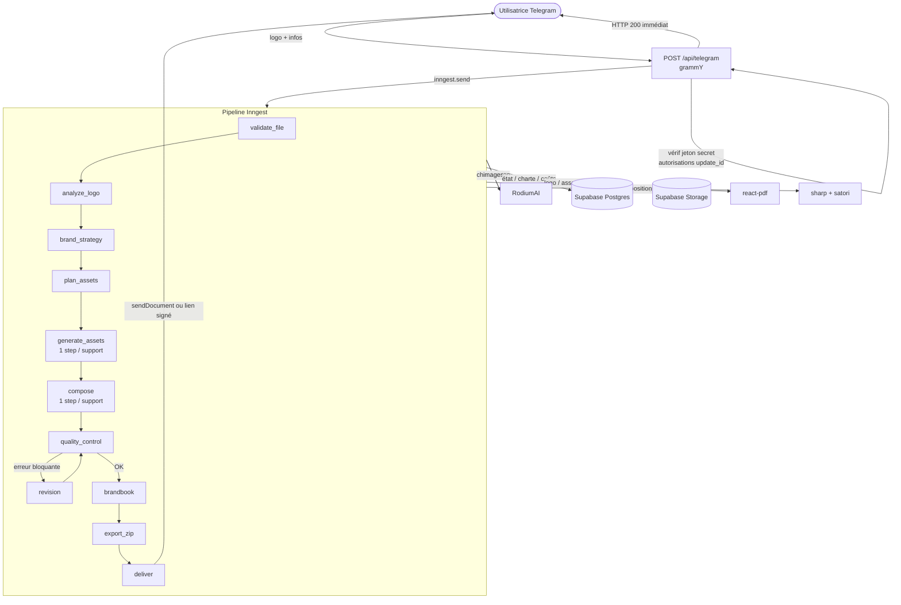
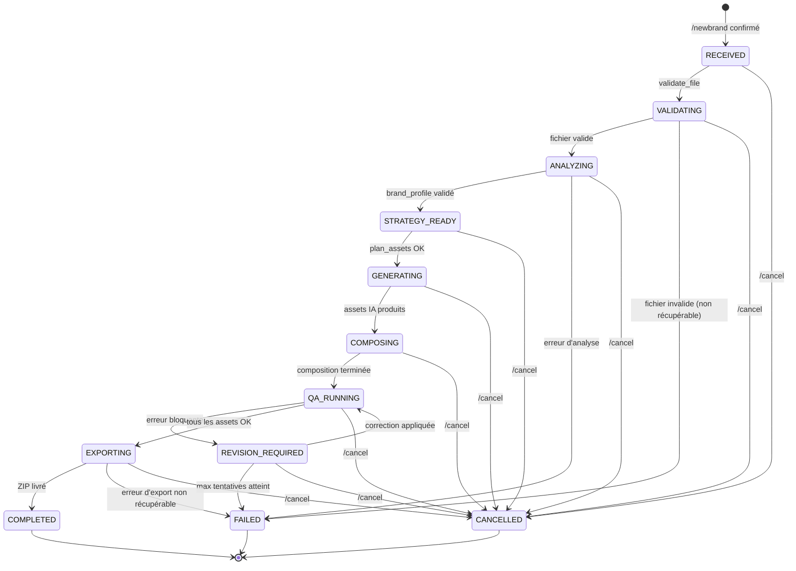
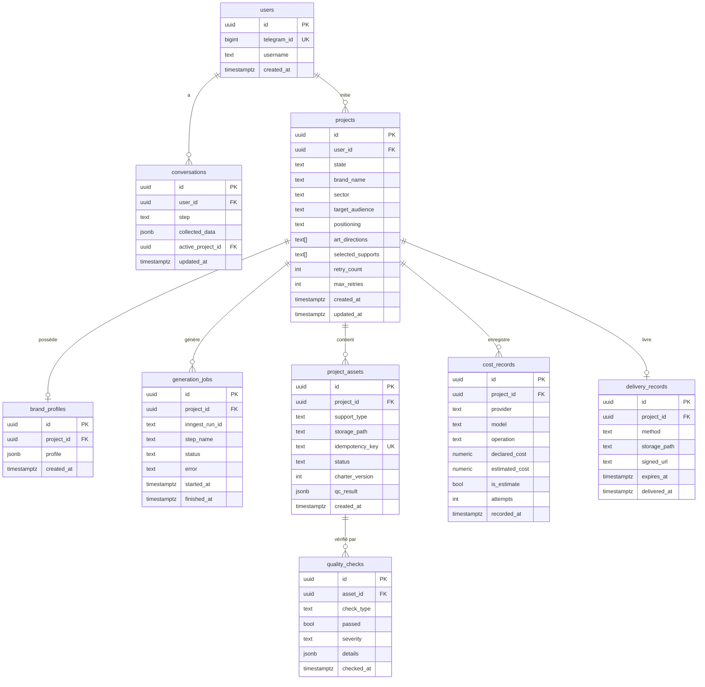

# Design Document

## Overview

Brand Studio est un bot Telegram personnel qui, à partir d'un logo fourni par l'utilisatrice, génère automatiquement une identité visuelle complète. Le traitement est entièrement asynchrone : le webhook répond à Telegram en moins de 2 secondes, puis délègue l'orchestration à Inngest. La composition graphique est réalisée par du code (sharp, satori), jamais par l'IA. L'IA (RodiumAI) intervient uniquement pour l'analyse sémantique du logo, la génération de la charte, la génération de fonds/scènes et le contrôle qualité optionnel par vision.

### Principes structurants

| Principe | Application |
|---|---|
| Réponse immédiate à Telegram | Le webhook HTTP retourne 200 avant tout traitement métier. |
| Idempotence stricte | Chaque asset possède une clé d'idempotence ; aucune génération déjà réussie n'est relancée. |
| Code contrôle les pixels | Le logo, les textes et les dimensions sont gérés par le code, jamais par un modèle IA. |
| Zéro secret dans les journaux | Tous les journaux sont JSON structurés ; clés, jetons, contenus utilisateur tronqués. |
| Validation par schéma zod | Toute donnée entrant ou sortant d'un module est validée avant usage. |
| Une étape Inngest = un support | Respecte la limite de 300 s par fonction Vercel Hobby. |

---

## Architecture

### Diagramme de flux principal



### Diagramme des transitions d'état du projet



---

## Components and Interfaces

### Structure des fichiers

```
brand_studio/
├── app/
│   ├── api/
│   │   └── telegram/
│   │       └── route.ts          # Webhook grammY (POST)
│   └── layout.tsx
├── jobs/
│   ├── validate-file.ts          # Étape Inngest 1
│   ├── analyze-logo.ts           # Étape Inngest 2
│   ├── brand-strategy.ts         # Étape Inngest 3
│   ├── plan-assets.ts            # Étape Inngest 4
│   ├── generate-assets.ts        # Étape Inngest 5 (1 step/support)
│   ├── compose.ts                # Étape Inngest 6 (1 step/support)
│   ├── quality-control.ts        # Étape Inngest 7
│   ├── revision.ts               # Étape Inngest 8 (conditionnel)
│   ├── brandbook.ts              # Étape Inngest 9
│   ├── export-zip.ts             # Étape Inngest 10
│   └── deliver.ts                # Étape Inngest 11
├── lib/
│   ├── bot/
│   │   ├── commands.ts           # /start, /help, /newbrand, /status, /cancel
│   │   ├── conversation.ts       # Parcours /newbrand, état de conversation
│   │   └── messages.ts           # Textes des messages Telegram
│   ├── config/
│   │   ├── env.ts                # Validation zod des variables d'environnement
│   │   ├── supports.ts           # Dimensions, marges, zones de sécurité par support
│   │   └── models.ts             # Modèles IA, limites de débit, prix unitaires
│   ├── db/
│   │   ├── client.ts             # Client Supabase (server-side)
│   │   ├── types.ts              # Types générés depuis le schéma
│   │   └── queries/              # Fonctions de requête par entité
│   ├── files/
│   │   ├── validate.ts           # Magic bytes, taille, dimensions
│   │   ├── svg-sanitize.ts       # Nettoyage SVG + rastérisation
│   │   └── storage.ts            # Upload/download Supabase Storage
│   ├── analysis/
│   │   ├── deterministic.ts      # sharp : dimensions, couleurs, alpha
│   │   └── semantic.ts           # Vision RodiumAI → brand_profile
│   ├── strategy/
│   │   └── charter.ts            # LLM → charte JSON validée
│   ├── planning/
│   │   └── assets.ts             # Plan d'assets + estimation coût
│   ├── ai/
│   │   ├── image-provider.ts     # Interface ImageProvider + implémentation RodiumAI
│   │   └── llm-client.ts         # Client LLM (chat + vision)
│   ├── compose/
│   │   ├── compositor.ts         # Orchestration sharp/satori par support
│   │   ├── logo-placer.ts        # Pose du logo (proportions, zone de sécurité, contraste)
│   │   └── text-renderer.ts      # Texte via satori (polices OFL locales)
│   ├── qc/
│   │   ├── checker.ts            # Contrôles déterministes
│   │   └── vision-check.ts       # Contrôle optionnel par vision IA
│   ├── brandbook/
│   │   └── pdf-generator.ts      # PDF @react-pdf/renderer (14 sections)
│   ├── export/
│   │   ├── zip-builder.ts        # ZIP structuré (archiver)
│   │   └── delivery.ts           # sendDocument ou lien signé
│   ├── state/
│   │   └── machine.ts            # Machine à états + transitions autorisées
│   ├── costs/
│   │   └── tracker.ts            # Enregistrement et contrôle des dépenses
│   └── logger.ts                 # Logger JSON structuré (sans secrets)
├── templates/
│   └── supports.config.ts        # Dimensions et règles par support (versionné)
├── supabase/
│   └── migrations/
│       ├── 0001_initial_schema.sql
│       ├── 0002_rls_policies.sql
│       └── ...
├── public/
│   └── fonts/                    # Polices OFL (TTF/OTF/WOFF)
├── tests/
│   ├── unit/
│   └── property/                 # Tests de propriété (Vitest + fast-check)
├── .env.example
├── inngest.ts                    # Client Inngest
└── next.config.ts
```

### Interfaces TypeScript principales

#### ImageProvider

```typescript
// lib/ai/image-provider.ts

export interface ImageGenerationRequest {
  prompt: string;
  width: number;
  height: number;
  model: string;
  /** Images de référence (Gemini Image uniquement, max 14, base64 data URL) */
  referenceImages?: string[];
  /** Clé d'idempotence : projectId + supportType + charterVersion */
  idempotencyKey: string;
}

export interface ImageGenerationResult {
  imageBase64: string;
  model: string;
  declaredCost?: number; // en RODI, si fourni par l'API
  estimatedCost: number; // toujours présent
  attempts: number;
  fromCache: boolean;
}

export interface ImageProvider {
  generate(request: ImageGenerationRequest): Promise<ImageGenerationResult>;
}

export interface ImageProviderConfig {
  model: string;
  endpoint: string;
  allowedDomains: string[];
  maxRequestBodyMib: number;
  maxRetries: number;
  unitPriceRodi: number;
  rpmLimit: number;
  rpdLimit: number;
}
```

#### BrandProfile

```typescript
// lib/analysis/types.ts

export type Uncertain = 'uncertain';

export interface DominantColor {
  hex: string;
  proportion: number; // 0–1
}

export interface BrandProfile {
  // Mesures déterministes (sharp)
  widthPx: number;
  heightPx: number;
  aspectRatio: number;          // width / height, arrondi à 4 décimales
  hasAlpha: boolean;
  dominantColors: DominantColor[];
  lowResolutionWarning: boolean;

  // Interprétation sémantique (vision IA)
  logoType: 'iconic' | 'wordmark' | 'combination' | 'emblem' | Uncertain;
  hasText: boolean | Uncertain;
  identifiedSymbols: string[] | Uncertain;
  perceivedStyle: string[] | Uncertain;
}

export const brandProfileSchema = z.object({ /* ... schéma zod complet */ });
```

#### Charte graphique

```typescript
// lib/strategy/types.ts

export interface ColorPalette {
  primary: string;    // hex
  secondary: string;
  accent: string;
  background: string;
  text: string;
}

export interface TypographyScale {
  xs: number; sm: number; base: number;
  lg: number; xl: number; xxl: number; // en px
}

export interface Charter {
  colors: ColorPalette;
  primaryFont: string;      // nom de famille (police OFL locale)
  secondaryFont: string;
  typographyScale: TypographyScale;
  spacingUnit: number;      // en px (base d'une grille 8 px par défaut)
  visualStyle: string[];    // ex. ["minimaliste", "géométrique"]
  logoRules: {
    safeZone: number;       // multiple du spacingUnit
    minSize: number;        // en px
    allowedBackgrounds: string[];
    forbiddenBackgrounds: string[];
  };
  forbidden: string[];      // interdits explicites
  version: number;          // incrémenté à chaque regénération
}

export const charterSchema = z.object({ /* ... schéma zod complet */ });
```

#### Machine à états

```typescript
// lib/state/machine.ts

export type ProjectState =
  | 'RECEIVED' | 'VALIDATING' | 'ANALYZING' | 'STRATEGY_READY'
  | 'GENERATING' | 'COMPOSING' | 'QA_RUNNING' | 'REVISION_REQUIRED'
  | 'EXPORTING' | 'COMPLETED' | 'FAILED' | 'CANCELLED';

export type ProjectTransition =
  | 'START_VALIDATION' | 'FILE_VALID' | 'FILE_INVALID'
  | 'ANALYSIS_DONE' | 'ANALYSIS_FAILED'
  | 'PLAN_READY' | 'GENERATION_DONE' | 'COMPOSITION_DONE'
  | 'QA_PASS' | 'QA_FAIL' | 'REVISION_DONE' | 'MAX_RETRIES'
  | 'EXPORT_DONE' | 'EXPORT_FAILED'
  | 'CANCEL';

/** Transitions autorisées : Map<état courant, transitions valides> */
export const ALLOWED_TRANSITIONS: Record<ProjectState, ProjectTransition[]> = {
  RECEIVED:           ['START_VALIDATION', 'CANCEL'],
  VALIDATING:         ['FILE_VALID', 'FILE_INVALID', 'CANCEL'],
  ANALYZING:          ['ANALYSIS_DONE', 'ANALYSIS_FAILED', 'CANCEL'],
  STRATEGY_READY:     ['PLAN_READY', 'CANCEL'],
  GENERATING:         ['GENERATION_DONE', 'CANCEL'],
  COMPOSING:          ['COMPOSITION_DONE', 'CANCEL'],
  QA_RUNNING:         ['QA_PASS', 'QA_FAIL'],
  REVISION_REQUIRED:  ['REVISION_DONE', 'MAX_RETRIES', 'CANCEL'],
  EXPORTING:          ['EXPORT_DONE', 'EXPORT_FAILED'],
  COMPLETED:          [],
  FAILED:             [],
  CANCELLED:          [],
};

export interface StateTransitionRecord {
  projectId: string;
  fromState: ProjectState;
  toState: ProjectState;
  transition: ProjectTransition;
  inngestStepId: string;
  timestamp: string; // ISO 8601
}

export interface StateMachine {
  /**
   * Applique une transition. Lance une erreur si la transition n'est pas autorisée
   * depuis l'état courant.
   */
  apply(
    projectId: string,
    transition: ProjectTransition,
    inngestStepId: string
  ): Promise<ProjectState>;

  /** Retourne l'état courant depuis la base. */
  current(projectId: string): Promise<ProjectState>;
}
```

#### Support (template)

```typescript
// templates/supports.config.ts

export interface SupportTemplate {
  id: string;         // ex. 'avatar' | 'banner' | 'business-card' | 'post-square' | 'post-vertical'
  label: string;
  widthPx: number;
  heightPx: number;
  margins: { top: number; right: number; bottom: number; left: number };
  safeZone: number;   // px minimum autour du logo
  logoMaxWidthRatio: number;  // ex. 0.5 = logo max 50% de la largeur
  printReady: boolean;
}
```

---

## Data Models

### Schéma de base de données



### Politiques Row Level Security

Toutes les tables appliquent RLS. Règle générale : seul le service role (côté serveur Next.js) peut lire et écrire. Aucun accès direct depuis le client browser. La politique est définie dans la migration `0002_rls_policies.sql`.

### Supabase Storage — structure des buckets

```
bucket: brand-studio (privé)
  {project_id}/
    logo/
      original/           # Logo_Original conservé intact
      processed/          # Logo rastérisé / redimensionné
    assets/
      {support_type}/     # PNG composé
    mockups/
      {category}/
    brandbook/
      brandbook.pdf
    export/
      {project_id}.zip
    temp/                 # Fichiers intermédiaires (supprimés après usage)
```

---

## Flux de données par module

### 1. Réception Telegram (`app/api/telegram/`)

```
Telegram POST → vérif X-Telegram-Bot-Api-Secret-Token
  → 403 si absent/incorrect
  → déduplication update_id (table conversations ou cache)
  → update_id déjà vu → 200 sans traitement
  → bot.handleUpdate(update) [grammY]
    → commande reconnue → persister état conversation
    → inngest.send({ name: 'brand-studio/project.start', data: { projectId } })
  → HTTP 200 (< 2 s)
```

### 2. Validation du fichier (`lib/files/`)

```
Téléchargement depuis Telegram (20 Mo max)
  → DetectMimeType(buffer) via magic bytes
  → type ∉ {PNG, JPEG, SVG} → rejeter + notifier
  → taille > 20 Mo → rejeter + notifier
  → dimensions > maxDimensions → rejeter + notifier
  → SVG : SanitizeSVG(buffer) → rastériser sans réseau
  → Upload logo/original/ + logo/processed/ dans Storage
  → transition VALIDATING → ANALYZING
```

### 3. Analyse du logo (`lib/analysis/`)

```
Téléchargement logo/processed/ depuis Storage
  → DeterministicAnalysis(buffer) [sharp]
    → dimensions, ratio, hasAlpha
    → couleurs dominantes sur pixels opaques (alpha > 0)
    → lowResolutionWarning si < seuil configuré
  → SemanticAnalysis(buffer) [RodiumAI vision]
    → resize < 10 Mio avant envoi
    → valider réponse par brandProfileSchema zod
    → champs non conformes → 'uncertain'
  → merger → BrandProfile validé
  → persister brand_profiles
  → transition ANALYZING → STRATEGY_READY
```

### 4. Génération de la charte (`lib/strategy/`)

```
BrandProfile + informations de marque
  → prompt LLM (RodiumAI)
  → valider réponse par charterSchema zod
  → invalide → retry (max configuré)
  → max atteint → FAILED
  → persister en base (charte versionnée)
  → transition STRATEGY_READY → GENERATING (via plan_assets)
```

### 5. Planification des assets (`lib/planning/`)

```
Charte + supports sélectionnés par l'utilisatrice
  → pour chaque support :
    → générer idempotency_key = hash(projectId + supportType + charterVersion)
    → vérifier si asset déjà en base avec cette clé
    → estimer coût unitaire (modèle × résolution)
  → calculer coût total estimé
  → coût > plafond configuré → demander confirmation
  → persister plan dans project_assets
```

### 6. Génération IA des fonds (`lib/ai/`)

```
Pour chaque support (1 étape Inngest) :
  → vérifier idempotency_key en base → skip si déjà produit
  → ImageProvider.generate(request)
    → vérifier domaine dans allowedDomains
    → construire corps < 10 Mio (resize références si nécessaire)
    → POST /v1/images/generations
    → 429 → attendre Retry-After → retry (max configuré)
    → succès → sauvegarder résultat + enregistrer coût
    → échec → propager erreur structurée
```

### 7. Composition graphique (`lib/compose/`)

```
Pour chaque support (1 étape Inngest) :
  → charger fond IA depuis Storage
  → charger Logo_Original depuis Storage (jamais modifié)
  → charger polices OFL depuis public/fonts/
  → LogoPlacer.place(logo, template, charter)
    → calculer position respectant zone de sécurité
    → vérifier contraste (WCAG AA : 4,5:1 texte, 3:1 graphique)
    → contraste insuffisant → ajouter fond intermédiaire
  → TextRenderer.render(brandName, slogan, charter) [satori → SVG → PNG]
  → Compositor.compose(background, logo, text) [sharp]
  → vérifier proportions logo : |ratio_composé / ratio_original - 1| ≤ 0.01
  → sauvegarder PNG dans assets/{support_type}/
```

### 8. Contrôle qualité (`lib/qc/`)

```
Pour chaque asset :
  → vérifications déterministes (avant tout appel IA) :
    → dimensions exactes du support (en px)
    → proportions logo ± 1 %
    → présence et exactitude du nom de marque (comparaison stricte)
    → contraste WCAG calculé
  → erreur bloquante → déclencher correction ciblée
  → max tentatives atteint → FAILED
  → tous assets OK → EXPORTING
```

### 9. Génération du PDF (`lib/brandbook/`)

```
Charte + assets + brand_profile + informations de marque
  → PdfGenerator.generate() [@react-pdf/renderer]
    → 14 sections obligatoires
    → polices OFL incorporées depuis public/fonts/
    → textes sélectionnables (non aplatis)
  → vérifier présence de toutes les sections
  → section manquante → erreur bloquante
  → sauvegarder brandbook.pdf dans Storage
```

### 10. Export ZIP (`lib/export/`)

```
Tous assets + PDF
  → structure stable versionnée :
    logo/, assets/, mockups/, brandbook/, README.txt
  → générer README.txt (liste fichiers, formats, dimensions, print/présentation)
  → compresser (archiver)
  → taille < 50 Mo → sendDocument Telegram
  → taille ≥ 50 Mo → lien signé Supabase Storage (expiration configurée)
  → supprimer fichiers temporaires temp/
  → transition EXPORTING → COMPLETED
```

---

## Error Handling

### Catégories d'erreurs

| Catégorie | Comportement | Exemple |
|---|---|---|
| Erreur transitoire réseau | Backoff exponentiel + retry (max configuré) | Timeout HTTP, 503 |
| Rate limit RodiumAI (429) | Attendre `Retry-After` + retry | 429 avec header |
| Erreur IA non récupérable | Marquer `uncertain` ou FAILED selon criticité | Réponse hors schéma |
| Erreur bloquante QC | Correction ciblée (max tentatives) | Logo déformé |
| Erreur budget dépassé | Arrêt immédiat → FAILED + notification | Coût > plafond |
| Erreur d'envoi Telegram | Retry → lien signé en substitut | sendDocument échoue |
| Transition d'état invalide | Exception levée + journalisation | Transition non autorisée |

### Backoff exponentiel

```typescript
// Stratégie de retry dans Inngest
const delay = Math.min(
  initialDelayMs * Math.pow(2, attempt),
  maxDelayMs
);
// Jitter : delay * (0.75 + Math.random() * 0.5)
```

### Journalisation structurée

```typescript
// lib/logger.ts — format de log JSON
interface LogEntry {
  level: 'info' | 'warn' | 'error';
  timestamp: string;        // ISO 8601
  projectId?: string;       // jamais d'identifiant personnel
  step?: string;            // nom de l'étape Inngest
  message: string;          // jamais de secret, jamais de clé API
  // Les champs suivants ne dépassent jamais 100 caractères
  userInputSummary?: string; // troncature à 100 chars si présent
  error?: {
    code: string;
    model?: string;
    operation?: string;
    attempts?: number;
    // jamais de stack trace dans les messages Telegram
  };
}
```

---

## Testing Strategy

### Approche double

| Type | Outil | Périmètre |
|---|---|---|
| Tests unitaires (exemples) | Vitest | Validation de schéma, logique métier, cas limites, gestion d'erreurs |
| Tests de propriété (PBT) | Vitest + fast-check | Invariants universels, round-trip, idempotence |
| Tests d'intégration | Vitest + Supabase local | Interactions DB, pipeline complet sur un projet factice |

### Bibliothèque PBT

**fast-check** est utilisé pour les tests de propriété. Chaque test PBT est configuré pour s'exécuter avec un minimum de 100 itérations.

Format de tag obligatoire pour chaque test de propriété :
```
// Feature: brand-studio-full, Property N: <texte de la propriété>
```

### Tests unitaires prioritaires (non-propriété)

- Validation zod des variables d'environnement (toutes les variables obligatoires manquantes)
- Magic bytes : PNG, JPEG, SVG, fichiers piégés
- SVG sanitization : balises `<script>`, handlers `on*`, URL externes supprimés
- Machine à états : transitions autorisées et rejetées
- Calcul du contraste WCAG (formules de luminance relative)
- Calcul des couleurs dominantes sur pixels opaques
- Plafond de dépense : arrêt au bon moment
- Journaux : aucun secret dans la sortie

### Configuration Vitest recommandée

```typescript
// vitest.config.ts
export default defineConfig({
  test: {
    globals: true,
    environment: 'node',
  },
});
```

---

## Correctness Properties

*Une propriété est une caractéristique ou un comportement qui doit être vrai pour toutes les exécutions valides du système — c'est une affirmation formelle sur ce que le système doit faire. Les propriétés servent de pont entre les spécifications lisibles par des humains et les garanties de correction vérifiables par machine.*

**Réflexion sur la redondance appliquée :**
- Les propriétés 3 et 4 (machine à états) sont complémentaires et non redondantes : l'une couvre les séquences valides, l'autre les transitions invalides — les deux sont conservées.
- L'idempotence de `ImageProvider` et l'idempotence de la génération de charte sont consolidées en une seule propriété d'idempotence des opérations coûteuses (Propriété 6).
- Le rejet des chaînes whitespace-only et la validation de longueur sont fusionnés en une seule propriété de validation des champs texte (Propriété 7).

---

#### Property 1: Idempotence de l'analyse déterministe du logo

*Pour tout* logo PNG valide, l'exécution successive de l'analyse déterministe (sharp) doit produire un BrandProfile identique — mêmes dimensions, même ratio, mêmes couleurs dominantes, même flag `lowResolutionWarning`.

**Valide : Exigence 8.5**

---

#### Property 2: Round-trip de sérialisation (BrandProfile et Charte)

*Pour tout* objet valide appartenant au type BrandProfile ou au type Charte, désérialiser le JSON produit par la sérialisation doit retourner un objet structurellement équivalent à l'objet d'origine — aucun champ ne doit être perdu, modifié ou ajouté.

**Valide : Exigences 26.1, 26.2, 26.3**

---

#### Property 3: Transitions d'état valides mènent à un état terminal

*Pour toute* séquence de transitions autorisées par `ALLOWED_TRANSITIONS` depuis l'état initial RECEIVED, l'état final atteint doit appartenir à l'ensemble {COMPLETED, FAILED, CANCELLED} — la machine à états ne peut pas rester bloquée dans un état intermédiaire.

**Valide : Exigence 18.5**

---

#### Property 4: Transition non autorisée toujours rejetée

*Pour tout* état courant du projet et toute transition absente de `ALLOWED_TRANSITIONS[état courant]`, la machine à états doit lever une erreur et laisser l'état en base inchangé.

**Valide : Exigence 18.2**

---

#### Property 5: Invariant de proportion du logo composé

*Pour tout* logo et tout support, le ratio largeur/hauteur du logo posé dans l'asset composé doit être égal au ratio du Logo_Original à ± 1 % — aucune déformation n'est tolérée.

**Valide : Exigence 13.6**

---

#### Property 6: Idempotence des opérations coûteuses

*Pour tout* appel à une opération coûteuse (génération d'image via `ImageProvider.generate()` ou génération de charte via le LLM) dont la clé d'idempotence est déjà présente en base, l'appel doit retourner le résultat existant sans émettre aucun nouvel appel vers l'API externe — le compteur d'appels API ne doit pas augmenter.

**Valide : Exigences 3.6, 10.5, 20.4**

---

#### Property 7: Validation des champs texte du parcours /newbrand

*Pour toute* chaîne soumise comme champ texte (nom de marque, secteur, public cible, positionnement) dont la longueur effective (après trim) est inférieure à 1 ou supérieure à 200 caractères, ou qui est composée uniquement de caractères d'espacement, la validation doit rejeter la saisie et maintenir l'état de conversation inchangé.

**Valide : Exigence 5.3**

---

#### Property 8: Détection du type réel par magic bytes

*Pour tout* buffer de fichier, le type détecté par le Validateur doit correspondre aux octets de signature du buffer, indépendamment de l'extension déclarée ou du type MIME fourni par Telegram — un buffer PNG avec extension `.pdf` doit être reconnu comme PNG.

**Valide : Exigence 7.1**

---

#### Property 9: Isolation des pixels transparents dans le calcul des couleurs dominantes

*Pour tout* logo PNG avec canal alpha, les couleurs dominantes calculées ne doivent contenir aucune contribution de pixels dont le canal alpha est égal à zéro — le résultat doit être identique à celui calculé sur les seuls pixels opaques.

**Valide : Exigence 8.2**

---

#### Property 10: Invariant du contenu du ZIP

*Pour tout* projet complété, la liste des fichiers produits par la décompression du ZIP doit correspondre exactement à la liste déclarée dans le README.txt — aucun fichier ne doit être absent, en surplus ou renommé.

**Valide : Exigence 17.5**

---

#### Property 11: Déduplication des mises à jour Telegram

*Pour tout* `update_id` déjà traité, un second traitement du même `update_id` ne doit déclencher aucune logique métier — aucun projet ne doit être créé, aucun état de conversation ne doit être modifié.

**Valide : Exigence 4.4**

---

#### Property 12: Isolation des utilisateurs non autorisés

*Pour tout* message Telegram dont l'identifiant expéditeur n'appartient pas à la liste d'autorisation, le bot ne doit émettre aucune réponse et ne doit déclencher aucune opération — aucune trace de l'identifiant non autorisé ne doit apparaître dans les journaux d'application.

**Valide : Exigence 4.3**

---
